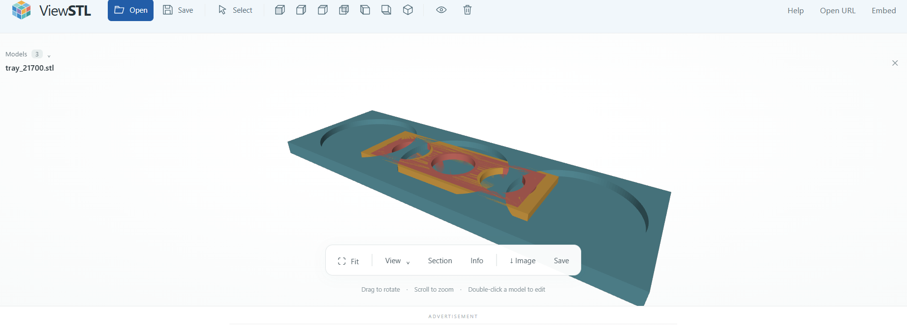
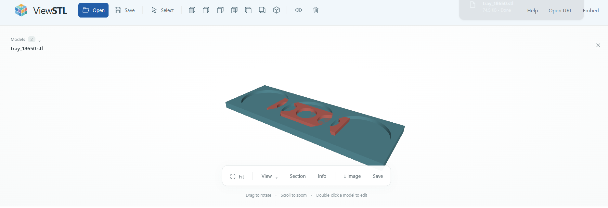
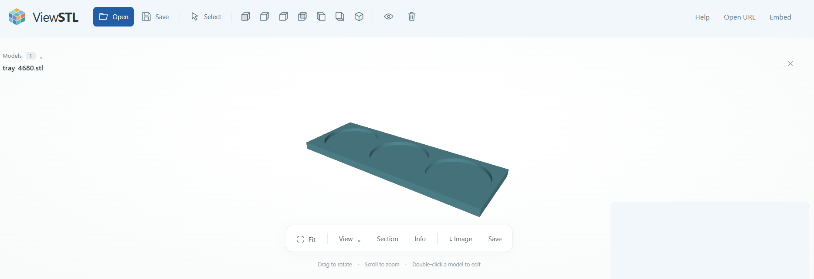

# 📘 DAY 10 – Three-Format Battery Tray

**Date:** 26 November 2026

## Project Overview
A parametric battery tray was designed using Python and CadQuery to accommodate three different cylindrical battery formats: 18650, 21700 and 4680.

## Objectives
- Implemented Python dataclasses to organize battery specifications.
- Developed a reusable parametric tray function.
- Generated three circular pockets using loops.
- Exported the final CAD models in STL format.

## Battery Specifications

| Battery Format | Diameter | Height |
|---|---:|---:|
| 18650 | 18 mm | 65 mm |
| 21700 | 21 mm | 70 mm |
| 4680 | 46 mm | 80 mm |

## Tools Used
- Python
- CadQuery
- Visual Studio Code
- GitHub

## 3D Model Visualizations

### Tray 1 – 18650 Battery Format

### Tray 2 – 21700 Battery Format

### Tray 3 – 4680 Battery Format

## Project Files
- `models.py` – Python source code
- `tray_18650.stl` – 18650 battery tray
- `tray_21700.stl` – 21700 battery tray
- `tray_4680.stl` – 4680 battery tray

## Learning Outcome
Successfully demonstrated parametric CAD modelling by using a single reusable function to generate multiple battery tray variants through changes in input specifications.
