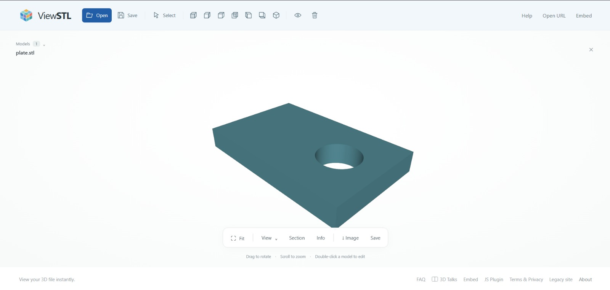
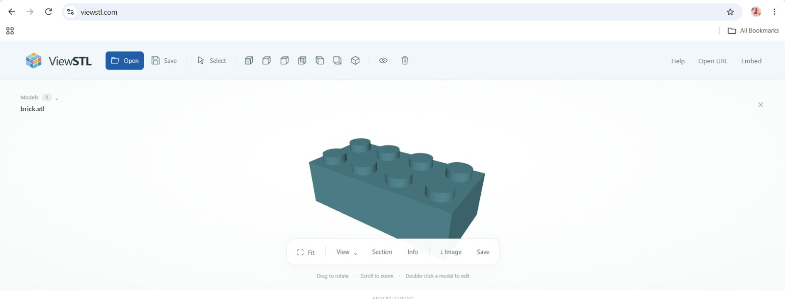

# Intelligent Manufacturing Systems & AI-Based Process Optimization
## Python-Based Parametric CAD Modelling Challenges

**Name:** Aditi Kar  
**Roll Number:** 2302110011  
**Repository:** `ims-ai-2302110011`

---

## Project Overview

This repository was developed as part of the Intelligent Manufacturing Systems and AI-Based Process Optimization learning programme. It documented the implementation of Python-based parametric CAD modelling exercises using the CadQuery library.

The challenges involved the creation of three-dimensional geometric models, the application of Boolean operations, parametric positioning, iterative modelling using Python loops, geometric validation, volume calculations, and STL file generation.

## Day 07 – Parametric Plate Modelling

A rectangular plate with a cylindrical through-hole was modelled using CadQuery.

### Operations Performed
- Created an 80 × 50 × 10 mm rectangular solid.
- Generated a cylindrical cutting tool with a 20 mm diameter and 10 mm height.
- Translated the cylindrical geometry by 20 mm along the X-axis.
- Applied Boolean subtraction to produce the through-hole.
- Validated the resulting solid and calculated its volume.
- Exported the completed CAD geometry in STL format.

**Calculated Volume:** 36,858.4 mm³  
**Geometry Validation:** Successful

**Output File:** `plate.stl`

### 3D Model Preview

---

## Day 08 – Parametric 2 × 4 Clutch Brick Modelling

A 2 × 4 toy brick was constructed by combining a rectangular base body with eight cylindrical studs arranged in two rows and four columns.

### Operations Performed
- Created a rectangular brick body measuring 31.2 × 15.6 × 9.6 mm.
- Generated cylindrical studs with a diameter of 4.8 mm and a height of 1.7 mm.
- Implemented nested Python `for` loops to generate and position eight studs.
- Applied parametric translations to achieve uniform stud spacing.
- Combined the studs with the main body using Boolean union operations.
- Calculated the theoretical volume and verified the model using an assertion statement.
- Exported the completed geometry in STL format.

**Number of Studs:** 8  
**Arrangement:** 2 × 4  
**Output File:** `brick.stl`

### 3D Model Preview

---

## Technologies and Concepts Used

- **Programming Language:** Python
- **CAD Library:** CadQuery
- **Geometric Modelling:** Parametric 3D modelling
- **Boolean Operations:** Subtraction and union
- **Programming Concepts:** Functions, nested loops and variables
- **Geometric Validation:** Solid validity checks and volume verification
- **File Export:** STL (Stereolithography)